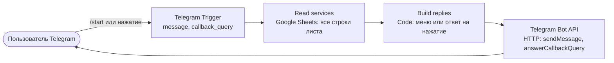

# Задача 1. Telegram-бот с динамическим меню в n8n

По команде `/start` бот читает таблицу услуг и показывает по inline-кнопке на каждую активную услугу. По нажатию определяет услугу по ID и присылает её название. Меню целиком задаётся данными: добавление, переименование, отключение или удаление услуги не требует правок workflow.

| Файл | Что это |
|---|---|
| [`workflow.json`](workflow.json) | экспорт workflow (без токена и credentials) |
| [`services.csv`](services.csv) | тестовая таблица для импорта в Google Sheets |
| [`test/workflow.test.mjs`](test/workflow.test.mjs) | автотесты логики на сценариях из задания |

## Как устроено



1. **Telegram Trigger** — webhook на апдейты `message` и `callback_query`.
2. **Read services** — на каждый апдейт заново читает лист `services`, поэтому бот всегда видит актуальные данные. Включён *Always Output Data*: пустой лист тоже доходит до следующего узла, и бот отвечает, что услуг нет.
3. **Build replies** — вся логика в одном Code-узле. На выходе элементы `{ method, payload }` — готовые запросы к Bot API:
   - `/start` → `sendMessage` с `reply_markup.inline_keyboard`: по кнопке на каждую активную услугу, `callback_data = "svc:<id>"`. Если активных нет — «Сейчас нет доступных услуг. Загляните позже.»;
   - нажатие → ID из `callback_data` ищется среди активных услуг в свежих данных → «Вы выбрали услугу: <название>». Если услугу отключили или удалили после показа меню — «Эта услуга больше недоступна. Отправьте /start, чтобы обновить меню.» Плюс `answerCallbackQuery`, чтобы на кнопке погас индикатор загрузки;
   - любое другое сообщение → подсказка отправить `/start`.
4. **Telegram Bot API** — HTTP Request: `POST https://api.telegram.org/bot<токен>/{{ $json.method }}` с телом `{{ JSON.stringify($json.payload) }}`.

**Почему так**

- Штатный узел Telegram задаёт клавиатуру статически, в интерфейсе: число кнопок из данных он не поддерживает. Поэтому тело запроса собирается в Code-узле, а отправляется через HTTP Request.
- В кнопке хранится только ID: `callback_data` ограничен 64 байтами (кириллическое название длиннее 32 символов уже не поместится), а ID не меняется при переименовании. Название ищется по ID в актуальной таблице, поэтому даже кнопка из старого меню вернёт новое название.
- Устойчивость к данным: заголовки сравниваются без учёта регистра (`ID`, `Name`); признак активности понимает чекбокс (`TRUE`), `true`, `1`, `yes`, `да`; строки без ID или названия пропускаются; при дублях ID берётся первая активная строка; соблюдаются лимиты Telegram — до 100 кнопок и 64 байта `callback_data`.

## Тестовая таблица

Лист `services`, первая строка — заголовки:

| Колонка | Тип | Назначение |
|---|---|---|
| `id` | число или короткий текст, уникальный | идентификатор услуги, уходит в `callback_data` |
| `name` | текст | название на кнопке |
| `active` | чекбокс (TRUE / FALSE) | показывать ли услугу в меню |

Содержимое [`services.csv`](services.csv) — 10 вымышленных услуг, 9 активных:

| id | name | active |
|---|---|---|
| 1 | Консультация | ✅ |
| 2 | Доставка курьером | ✅ |
| 3 | Самовывоз | ✅ |
| 4 | Подарочная упаковка | ✅ |
| 5 | Подарочный сертификат | ✅ |
| 6 | Предзаказ | ✅ |
| 7 | Персональная подборка | ✅ |
| 8 | Обмен и возврат | ✅ |
| 9 | Корпоративный заказ | ✅ |
| 10 | Мастер-класс | ⬜ |

## Запуск

1. **Бот.** В [@BotFather](https://t.me/BotFather) выполнить `/newbot` и сохранить токен.
2. **Таблица.** Google Sheets → Файл → Импорт → Загрузка → `services.csv` → «Создать таблицу». Лист получит имя `services` (если нет — переименовать). Выделить колонку `active` → Вставка → Флажок: значения TRUE/FALSE станут чекбоксами.
3. **n8n.** Нужен инстанс с публичным HTTPS-адресом — n8n Cloud или self-hosted с `WEBHOOK_URL`: Telegram доставляет апдейты на webhook. Workflows → Import from File → `workflow.json`.
4. **Настроить узлы:**
   - *Telegram Trigger* → Credential → Create new → Telegram API → токен бота;
   - *Read services* → Credential → Google Sheets OAuth2 (в n8n Cloud — «Sign in with Google»; в self-hosted — OAuth-клиент Google Cloud или Service Account, которому открыт доступ к таблице), в поле Document вставить ссылку на таблицу;
   - *Telegram Bot API* → в URL заменить `YOUR_BOT_TOKEN` на токен бота.
5. **Активировать** workflow (Publish / Active) — n8n сам зарегистрирует webhook.
6. Написать боту `/start`.

> У бота один webhook. Тестовый запуск из редактора временно переключает его на тестовый URL — после проверки активируйте workflow снова.
>
> Перед повторным экспортом верните в URL `YOUR_BOT_TOKEN` (credentials в экспорт не попадают). В продакшене на своём сервере токен лучше брать из переменной окружения: `bot{{ $env.TELEGRAM_BOT_TOKEN }}`. В n8n 2.x доступ к переменным окружения по умолчанию закрыт — нужен `N8N_BLOCK_ENV_ACCESS_IN_NODE=false`; в n8n Cloud переменных окружения нет.

## Сценарий демонстрации

| # | Действие в таблице | Ожидаемый результат в Telegram |
|---|---|---|
| 1 | исходные данные | `/start` → 9 кнопок |
| 2 | снять флажки у id 6–9 | `/start` → 5 кнопок |
| 3 | снять флажки у id 3–5 | `/start` → 2 кнопки |
| 4 | добавить строку `11 · Экспресс-доставка · ✅` | `/start` → новая кнопка в конце списка |
| 5 | переименовать id 1 в «Консультация онлайн» | `/start` → новое название; кнопка из старого меню тоже вернёт новое название |
| 6 | снять флажок у id 2 | `/start` → кнопки нет; нажатие на неё в старом меню → «Эта услуга больше недоступна…» |
| 7 | нажимать разные кнопки | «Вы выбрали услугу: <название>» для каждой |
| 8 | снять все флажки | `/start` → «Сейчас нет доступных услуг. Загляните позже.» |

## Как проверено

- **Автотесты:** `node --test task1-telegram-bot/test/workflow.test.mjs` (Node 18+, без зависимостей). Тест берёт код узла *Build replies* прямо из `workflow.json` и прогоняет сценарии задания: меню на 2, 5 и 9 услуг, добавление, переименование, отключение и удаление, пустую таблицу, нажатия, кнопки из старого меню, варианты команды, форматы данных. Отдельно проверяются связи узлов и отсутствие токена в экспорте. Результат: 10 из 10.
- **Настоящий n8n 2.46.4 в Docker:** параметры всех узлов сверены со схемами n8n (неизвестных параметров и ошибок нет), workflow импортируется через `n8n import:workflow`. Копия workflow, в которой триггер и Google Sheets заменены фиксированными данными, а Telegram — локальным моком, выполнена через `n8n execute`. Запросы, которые реально ушли в Bot API:

  ```text
  POST /bot…/sendMessage {"chat_id":42,"text":"Выберите услугу:","reply_markup":{"inline_keyboard":[[{"text":"Консультация","callback_data":"svc:1"}],[{"text":"Самовывоз","callback_data":"svc:3"}]]}}
  POST /bot…/sendMessage {"chat_id":42,"text":"Вы выбрали услугу: Самовывоз"}
  POST /bot…/answerCallbackQuery {"callback_query_id":"cb-1"}
  ```

- Не проверено в этой среде: живой бот и Google-таблица — для них нужны токен и Google-аккаунт; это шаги демонстрации выше.

## Ограничения

- Токен бота задаётся в URL узла, а не в credentials: credentials Telegram в n8n не подключаются к HTTP Request, потому что Bot API ждёт токен в пути URL. Для продакшена — переменная окружения.
- Таблица читается на каждый апдейт, даже на посторонние сообщения. При большом трафике упрёмся в квоту Google Sheets API (60 запросов чтения в минуту на пользователя) — тогда нужны Switch перед чтением и кеш на 30–60 секунд.
- Ошибка чтения таблицы (квота, отозванный доступ, переименованный лист) отдельной веткой не обрабатывается: бот не ответит. Для продакшена — error output у «Read services» с ответом «Сервис временно недоступен» и `answerCallbackQuery`.
