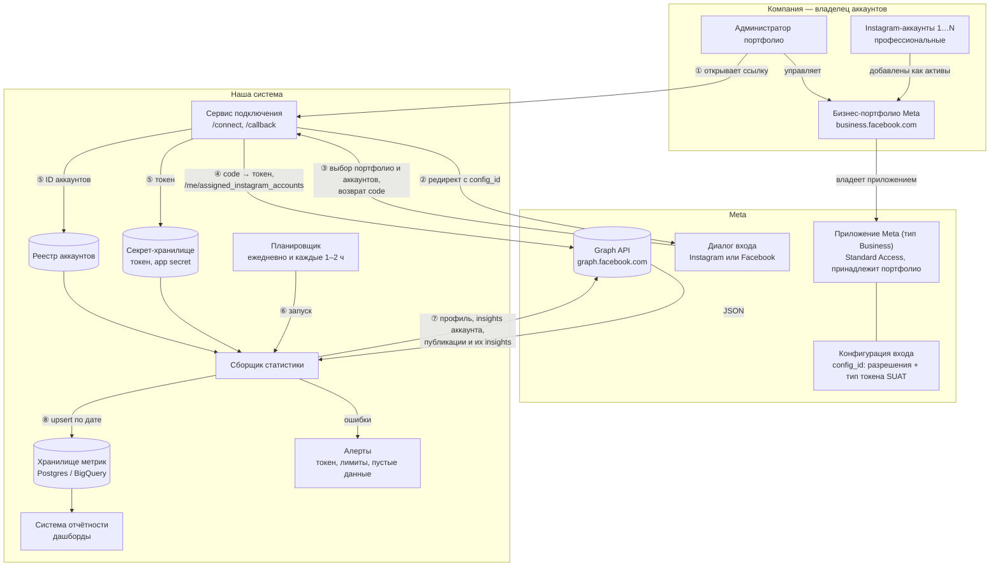
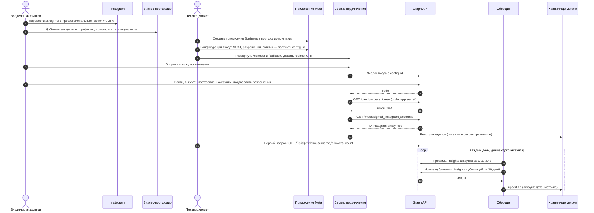

# Задача 2. Подключение Instagram-аккаунтов к сбору статистики

> План опирается на официальную документацию Meta Instagram Platform (ноябрь 2026; примеры — Graph API v26.0). Интеграцию и реальные доступы по условию не создавал, поэтому всё, что зависит от конкретных аккаунтов, вынесено в пилот (шаги 12–14) и в вопросы к компании.

## 1. Коротко

1. Статистику даёт только официальный **Instagram API (Meta Graph API)**. Парсинг и неофициальные API не рассматриваю: они нарушают правила платформы и регулярно ломаются.
2. Каждый аккаунт должен быть **профессиональным** (Business или Creator). У личных аккаунтов статистики в API нет.
3. Аккаунты принадлежат компании, поэтому хватает **Standard Access**. App Review и Business Verification нужны, только если приложение обслуживает чужие аккаунты.
4. Способ подключения — **Instagram API with Unified Login**. Meta рекомендует его для новых интеграций, Facebook-страницы не нужны, а токен принадлежит бизнес-портфолио компании, а не сотруднику, и покрывает все переданные аккаунты. Если бизнес-портфолио нет и заводить его не хотят — запасной вариант **Instagram API with Instagram Login**: токен на каждый аккаунт, 60 дней с автопродлением.
5. Сбор — задача по расписанию: ежедневный снимок профиля, метрики аккаунта за последние 3 дня (данные приходят с задержкой до 48 часов) и метрики публикаций; запись в БД через upsert. Ошибки и состояние токенов уходят в алерты.

## 2. Варианты подключения

| | **Unified Login** (рекомендую) | Instagram Login (запасной) | Facebook Login (через страницу) |
|---|---|---|---|
| Назначение по Meta | новые интеграции | существующие интеграции | существующие интеграции со страницами |
| Вход владельца | логин Instagram или Facebook | логин Instagram | логин Facebook |
| Facebook-страница | не нужна | не нужна | обязательна, связанная с аккаунтом |
| Бизнес-портфолио Meta | обязательно | не нужно | зависит от схемы |
| Токен | Business Integration System User (SUAT): принадлежит портфолио, срок задаётся в конфигурации | Instagram User: 1 час → 60 дней, продлевается | Facebook User или Page |
| Хост API | `graph.facebook.com` | `graph.instagram.com` | `graph.facebook.com` |
| Разрешения для статистики | `instagram_basic`, `instagram_manage_insights` | `instagram_business_basic`, `instagram_business_manage_insights` | `instagram_basic`, `instagram_manage_insights`, `pages_show_list`, `pages_read_engagement` |
| Число токенов | один на портфолио | один на аккаунт | на пользователя или страницу |

Вариант со страницей имеет смысл, только если он у компании уже настроен и нужны возможности, которые Meta документирует только для Facebook Login: итоговые метрики с рекламой (`total_views`, `total_likes`, `total_comments`) и webhook `story_insights`.

## 3. Схема реализации

### 3.1. Компоненты и потоки данных



### 3.2. Последовательность — от аккаунта до первого запроса и регулярного сбора



## 4. Что с чем связано и у кого доступ

**Цепочка:** профессиональный Instagram-аккаунт → актив бизнес-портфолио компании → портфолио владеет приложением Meta → в приложении конфигурация входа (`config_id`: разрешения и тип токена) → вход администратора портфолио выдаёт SUAT на выбранные аккаунты → токен хранится только на сервере сборщика.

| Кто | Доступ | Зачем |
|---|---|---|
| Владелец аккаунтов (маркетинг) | логины и 2FA Instagram, администратор бизнес-портфолио | переводит аккаунты, добавляет их в портфолио, проходит вход и выбирает аккаунты |
| Второй администратор портфолио | администратор | резерв, чтобы не потерять доступ при уходе сотрудника |
| Техспециалист | аккаунт разработчика Meta; роль Admin или Developer в приложении; доступ к разделу «Приложения» в портфолио | создаёт приложение, сервис подключения и сборщик |
| Сборщик (сервер) | SUAT и app secret из секрет-хранилища | запрашивает API по расписанию |
| Пользователи отчётов | только чтение дашбордов или БД | к Instagram и токенам доступа не получают |

Права минимальные: только два разрешения на чтение (`instagram_basic`, `instagram_manage_insights`), без публикации и сообщений. App secret и токены — только на сервере, никогда в браузере, логах или репозитории.

## 5. Пошаговый план

| # | Кто | Действие | Результат |
|---|---|---|---|
| | | **Подготовка** | |
| 1 | компания и техспециалист | Ответить на вопросы из раздела 11, назначить ответственного со стороны компании | список аккаунтов, система отчётности, требования |
| | | **Владелец аккаунтов** | |
| 2 | владелец | В приложении Instagram: Настройки → «Тип аккаунта и инструменты» → «Переключиться на профессиональный аккаунт» → «Бизнес» (или «Автор») | в профиле появилась «Профессиональная панель» |
| 3 | владелец | Включить двухфакторную аутентификацию на всех аккаунтах | аккаунты защищены |
| 4 | владелец | Создать бизнес-портфолио на business.facebook.com, если его нет; назначить второго администратора | портфолио с двумя администраторами |
| 5 | владелец | Настройки компании → Аккаунты → Аккаунты Instagram → Добавить → войти в каждый аккаунт | аккаунты в списке активов портфолио |
| 6 | владелец | Пригласить техспециалиста в портфолио и открыть ему раздел «Приложения» | техспециалист видит портфолио |
| | | **Технический специалист** | |
| 7 | техспециалист | Зарегистрироваться на developers.facebook.com, включить 2FA | аккаунт разработчика |
| 8 | техспециалист | Создать приложение типа **Business** и привязать его к бизнес-портфолио компании | App ID и App Secret; приложение принадлежит компании |
| 9 | техспециалист | Добавить Instagram API (Unified Login, вход через Facebook Login for Business) и создать конфигурацию входа: тип токена — System-user access token, срок жизни, активы — аккаунты Instagram, разрешения `instagram_basic`, `instagram_manage_insights` | `config_id` |
| 10 | техспециалист | Указать Valid OAuth Redirect URI сервиса подключения, домен приложения и ссылку на политику конфиденциальности; уровень доступа оставить Standard | приложение готово ко входу |
| 11 | техспециалист | Сделать сервис подключения: `/connect` → диалог входа `https://www.facebook.com/v26.0/dialog/oauth?client_id=…&redirect_uri=…&config_id=…&response_type=code&state=…`; `/callback` → проверить `state`, обменять `code` на токен (`GET /oauth/access_token`), получить `/me/assigned_instagram_accounts`, сохранить токен в секрет-хранилище, аккаунты — в реестр | рабочая ссылка подключения |
| | | **Пилот на одном аккаунте** | |
| 12 | владелец | Открыть ссылку, войти через Instagram или Facebook, выбрать портфолио и один аккаунт, подтвердить разрешения | токен выдан, аккаунт в реестре |
| 13 | техспециалист | Первые запросы (раздел 7): профиль `GET /{ig-id}?fields=username,followers_count,media_count`, затем insights аккаунта и двух-трёх публикаций разных типов | цифры совпадают с профессиональной панелью с поправкой на задержку |
| 14 | техспециалист | Зафиксировать по пилоту: фактический срок токена, доступность каждой метрики из раздела 7, пороги (100 подписчиков), часовой пояс суток | подтверждённый список метрик и расписание |
| | | **Автоматически** | |
| 15 | сборщик | Ежедневно в 06:00 по каждому аккаунту из реестра: снимок профиля; метрики аккаунта за D-1…D-3; новые публикации; метрики публикаций за последние 30 дней (старше — раз в неделю) | строки в хранилище метрик |
| 16 | сборщик | Каждые 1–2 часа: активные Stories и их метрики, пока история не истекла (24 часа) | метрики Stories |
| 17 | сборщик | Ежедневно: проверка токена (`debug_token`), загрузки лимитов (`X-Business-Use-Case-Usage`) и полноты данных; алерт при сбое | алерт в Telegram или на почту |
| | | **Масштабирование** | |
| 18 | владелец и техспециалист | Пройти вход повторно и выбрать остальные аккаунты — они появятся в `/me/assigned_instagram_accounts`, сборщик подхватит их из реестра без изменения кода | все аккаунты в отчётах |
| 19 | техспециалист | Разово загрузить историю (аккаунт — до 90 дней, публикации — до 2 лет), собрать дашборд в системе отчётности | отчёт готов |

**Если выбран Instagram Login** (нет бизнес-портфолио): шаги 4–6 не нужны; на шаге 9 добавляется продукт Instagram с бизнес-входом, аккаунты добавляются в приложение в App Dashboard; на шаге 11 — свой OAuth (раздел 6.2) и токен на каждый аккаунт; в шаг 17 добавляется автопродление токенов.

## 6. Разрешения и токены

### 6.1. Unified Login (основной вариант)

- **Разрешения:** `instagram_basic` (профиль, список публикаций) и `instagram_manage_insights` (статистика).
- **Получение:** вход Facebook Login for Business с `config_id` → `code` → `GET https://graph.facebook.com/v26.0/oauth/access_token?client_id=<APP_ID>&client_secret=<APP_SECRET>&code=<CODE>` на сервере.
- **Что выдаётся:** Business Integration System User Access Token (в App Dashboard — «System-user access token»). Принадлежит портфолио, а не человеку, поэтому переживает уход сотрудника; покрывает все аккаунты, переданные приложению. `/me` возвращает системного пользователя, а не аккаунт, — ID аккаунтов берём из `/me/assigned_instagram_accounts`.
- **Срок жизни:** задаётся в конфигурации входа. Управление и продление — через API управления токенами системных пользователей (нужен ID бизнес-портфолио, сохраняем его вместе с токеном).
- **Когда перестаёт работать:** приложение удалили из портфолио или аккаунт перенесли в другое портфолио. Повторы бесполезны — нужно пройти вход заново.

### 6.2. Instagram Login (запасной вариант)

| Шаг | Запрос | Срок |
|---|---|---|
| Авторизация | `https://www.instagram.com/oauth/authorize?client_id=…&redirect_uri=…&response_type=code&scope=instagram_business_basic,instagram_business_manage_insights` | `code` действует 1 час, одноразовый |
| Короткий токен | `POST https://api.instagram.com/oauth/access_token` (`client_id`, `client_secret`, `grant_type=authorization_code`, `redirect_uri`, `code`) | 1 час |
| Долгий токен | `GET https://graph.instagram.com/access_token?grant_type=ig_exchange_token&client_secret=…&access_token=<короткий>` | 60 дней |
| Продление | `GET https://graph.instagram.com/refresh_access_token?grant_type=ig_refresh_token&access_token=<долгий>` | ещё 60 дней; токену должно быть не меньше 24 часов, и он не истёк |

Если токен не продлить за 60 дней, он истекает, и владельцу придётся пройти вход заново. Поэтому сборщик продлевает токены раз в неделю и поднимает алерт за 7 дней до `expires_at`.

### 6.3. Хранение и поддержка доступа

- Токены и app secret — в секрет-хранилище (Vault, облачный Secret Manager или зашифрованная колонка); рядом храним `expires_at`, ID портфолио, ID аккаунтов и `config_id`.
- Ежедневная проверка `GET https://graph.facebook.com/debug_token?input_token=<токен>&access_token=<APP_ID>|<APP_SECRET>`: `is_valid`, выданные разрешения, `expires_at`.
- Обмен `code` и вызовы с app secret — только на сервере. Токены не пишем в логи.

## 7. Таблица метрик

Запросы ниже — для `graph.facebook.com` (Unified Login). Для Instagram Login те же пути на `graph.instagram.com`.

| Показатель | Как получить | Период и глубина | Условия и ограничения |
|---|---|---|---|
| **Подписчики — текущее число** | поле профиля: `GET /{ig-user-id}?fields=followers_count,follows_count,media_count` | значение на момент запроса | истории в API нет — строим её сами ежедневными снимками |
| **Подписки и отписки** | `GET /{ig-user-id}/insights?metric=follows_and_unfollows&period=day&metric_type=total_value&breakdown=follow_type` | день, `since` / `until` | нет для аккаунтов меньше 100 подписчиков. Метрика `follower_count` упоминается в документации только в ограничениях и отсутствует в списке метрик — на неё не закладываемся, проверяем на пилоте |
| **Охват аккаунта** | `metric=reach&period=day`, `metric_type=total_value` (разбивки `media_product_type`, `follow_type`) или `time_series` | день или диапазон `since`–`until`; хранится до 90 дней | уникальные аккаунты, оценочное значение: охват за неделю не равен сумме дневных — запрашиваем `total_value` за весь диапазон |
| **Просмотры аккаунта** | `metric=views&period=day&metric_type=total_value` (разбивки по типу подписчика и `media_product_type`) | только `total_value`, поэтому дневной ряд — запрос на каждый день | заменяет `impressions`, удалённую 21.04.2025 во всех версиях API |
| **Вовлечённость аккаунта** | `accounts_engaged`, `total_interactions`, `likes`, `comments`, `shares`, `saves`, `replies`, `reposts` | день, `total_value` | `profile_views`, `website_clicks` и клики по контактам удалены 08.01.2025; переходы по ссылкам профиля — `profile_links_taps` |
| **Аудитория** (по желанию) | `follower_demographics`, `engaged_audience_demographics` с `timeframe=this_week` или `this_month` и `breakdown=age`, `city`, `country`, `gender` | `lifetime`, без `since` / `until` | от 100 подписчиков или вовлечений; только топ-45 значений |
| **Список публикаций** | `GET /{ig-user-id}/media?fields=id,caption,media_type,media_product_type,permalink,timestamp,like_count,comments_count` | постранично по курсору | только публикации этого аккаунта |
| **Пост или карусель** | `GET /{ig-media-id}/insights?metric=reach,views,likes,comments,saved,shares,total_interactions,follows,profile_visits,profile_activity` | накопительно за всё время; хранится до 2 лет | у элементов внутри карусели статистики нет — только у карусели целиком; `views` и `total_interactions` Meta помечает как «in development» |
| **Reels** | `reach,views,likes,comments,saved,shares,total_interactions,ig_reels_avg_watch_time,ig_reels_video_view_total_time,reels_skip_rate`; при кросспостинге в Facebook — `crossposted_views`, `facebook_views` | накопительно | `plays`, `clips_replays_count`, `ig_reels_aggregated_all_plays_count` удалены 21.04.2025, `video_views` — 08.01.2025 |
| **Stories** | `GET /{ig-user-id}/stories` → `GET /{story-id}/insights?metric=reach,views,replies,shares,follows,profile_visits,navigation,total_interactions` | только 24 часа жизни истории | собираем каждые 1–2 часа; при значениях меньше 5 — ошибка `(#10) Not enough viewers`; `replies` = 0 для зрителей из ЕС и Японии; webhook `story_insights` документирован только для Facebook Login |
| **Итоговые с рекламой** | `total_views`, `total_likes`, `total_comments` | накопительно | документированы только для Facebook Login; обычные метрики считают только органику |

**Общие ограничения**

- Данные приходят с задержкой до 48 часов — каждый день пересобираем последние 3 дня.
- Если данных нет, API возвращает пустой `data: []`, а не 0 — в хранилище это `NULL`, а не ноль.
- Глубина: метрики аккаунта — до 90 дней назад, метрики публикаций — до 2 лет. Статистика копится с момента перевода в профессиональный аккаунт.
- Insights запрашиваются по одному аккаунту за раз.
- Лимит Business Use Case: `4800 × число показов контента аккаунта за 24 часа` на пару «приложение — аккаунт». При ежедневном сборе запас большой; загрузку видно в заголовке `X-Business-Use-Case-Usage`, при ошибке `80002` — пауза до восстановления.

## 8. Несколько аккаунтов и регулярное сохранение

**Реестр аккаунтов** — источник правды для сборщика. Новый аккаунт = новая строка, код не меняется.

```sql
create table ig_accounts (
  ig_user_id      text primary key,
  username        text not null,
  business_id     text,                -- портфолио (Unified Login)
  token_ref       text not null,       -- ссылка на секрет, не сам токен
  status          text not null default 'active',  -- active | paused | reconnect_required
  connected_at    timestamptz not null default now(),
  last_success_at timestamptz
);

create table account_snapshots (       -- followers_count и др. на дату
  ig_user_id text, snapshot_date date, followers_count int, follows_count int, media_count int,
  primary key (ig_user_id, snapshot_date)
);

create table account_daily_metrics (   -- reach, views, ... за день
  ig_user_id text, date date, metric text, breakdown text not null default '', value bigint,
  collected_at timestamptz not null default now(),
  primary key (ig_user_id, date, metric, breakdown)
);

create table media (
  ig_media_id text primary key, ig_user_id text, media_type text, media_product_type text,
  permalink text, posted_at timestamptz, caption text
);

create table media_metrics (           -- накопительные значения на дату снимка → кривая роста
  ig_media_id text, snapshot_date date, metric text, value bigint,
  primary key (ig_media_id, snapshot_date, metric)
);

create table collector_runs (          -- журнал запусков для алертов и разбора
  id bigserial primary key, ig_user_id text, started_at timestamptz, finished_at timestamptz,
  status text, error text
);
```

**Правила сборщика**

- **Идемпотентность:** запись только через upsert по первичным ключам — повторный запуск или пересборка трёх дней не дают дублей.
- **Изоляция:** ошибка одного аккаунта не останавливает остальные; аккаунт с ошибкой токена переходит в `reconnect_required`, и уходит алерт.
- **Повторы:** при 5xx и лимитах — экспоненциальная пауза; при `190` (токен) и `10` / `200` (права) — без повторов, сразу алерт.
- **Нагрузка:** пачки запросов (batch до 50), выбор только нужных полей, равномерно по времени.
- **Время:** все даты храним в UTC, границы суток сверяем с профессиональной панелью на пилоте.
- **Реализация:** n8n (Schedule Trigger → Postgres: активные аккаунты → HTTP Request к Graph API → Postgres upsert → ветка ошибок в Telegram) или небольшой сервис на Python по cron. Дашборды — Looker Studio, DataLens или Metabase поверх таблиц.

## 9. План проверки

| Этап | Как проверить | Ожидаемый результат |
|---|---|---|
| Профессиональный аккаунт | профиль в приложении Instagram | есть «Профессиональная панель» и статистика |
| Аккаунты в портфолио | Настройки компании → Аккаунты Instagram | все аккаунты в списке, у техспециалиста есть доступ |
| Приложение | App Dashboard → Настройки → Основное | указано бизнес-портфолио компании, роли назначены, уровень доступа Standard |
| Конфигурация | App Dashboard → Facebook Login for Business → Configurations | есть `config_id` с двумя разрешениями и активами Instagram |
| Подключение | после входа `GET /me/assigned_instagram_accounts` | вернулись ID всех выбранных аккаунтов |
| Токен | `GET /debug_token` | `is_valid: true`, разрешения `instagram_basic` и `instagram_manage_insights`, ожидаемый `expires_at` |
| Профиль | `GET /{ig-id}?fields=username,followers_count,media_count` | совпадает с профилем в приложении |
| Insights аккаунта | `reach`, `views` за вчера | непустые значения, близкие к профессиональной панели (оценки и задержка до 48 ч допускают расхождение) |
| Insights публикаций | фото, карусель и Reels | метрики соответствуют типу, значения близки к статистике публикации в приложении |
| Stories | тестовая история, запрос в первые 24 часа | метрики есть; через 24 часа — данных нет, как и ожидается |
| Сборщик | два запуска подряд; затем испорченный токен у одного аккаунта | дублей нет; остальные аккаунты собраны, пришёл алерт, статус `reconnect_required` |
| Токен на дистанции | Unified Login — срок из конфигурации; Instagram Login — вызов продления | `expires_at` сдвигается, алерт за 7 дней срабатывает на тестовой дате |
| Лимиты | лог заголовка `X-Business-Use-Case-Usage` | загрузка далеко от 100 % |
| Отчётность | дашборд за последние 7 дней | все аккаунты, нет пропусков дат, выборочные цифры совпадают с приложением |

## 10. Типичные проблемы и как найти причину

| Симптом или ошибка | Вероятная причина | Как проверить и исправить |
|---|---|---|
| `(#10)` или `(#200)` Permission error | разрешение не выдано или не входит в конфигурацию; у вошедшего нет роли в портфолио или приложении | `debug_token` → список разрешений; поправить конфигурацию и пройти вход заново |
| `(#190)` Invalid OAuth access token | токен истёк (Instagram Login не продлили за 60 дней), сменили пароль, приложение удалили из портфолио, аккаунт перенесли в другое портфолио | `debug_token` → `is_valid`, `expires_at`; пройти вход заново, проверить расписание продления |
| `(#100)` metric не поддерживается | устаревшая метрика (`impressions`, `plays`, `video_views`, `profile_views`, `website_clicks`) или метрика не для этого типа публикации | сверить с разделом 7 и `media_product_type` публикации |
| «An unknown error has occurred» при запросе нескольких метрик | одна из метрик не поддерживает переданный `breakdown` | запрашивать метрики с разбивками отдельно |
| Пустой `data: []` | данные ещё не готовы (до 48 ч), аккаунт меньше 100 подписчиков, история истекла, период глубже 90 дней, публикация сделана до перевода в профессиональный аккаунт | проверить дату, порог и тип; пересобрать через 1–2 дня |
| `(#10) Not enough viewers` | у Stories значения меньше 5 | ожидаемо: записываем `NULL` |
| Нет статистики у элементов карусели | так устроен API | брать метрики карусели целиком |
| Аккаунта нет в `/me/assigned_instagram_accounts` | не добавлен в портфолио, не выбран при входе, аккаунт личный | проверить актив в портфолио и тип аккаунта, пройти вход и выбрать аккаунт |
| Ошибки `80002`, `4`, `17`, `613` | превышен лимит запросов | заголовки `X-Business-Use-Case-Usage` и `X-App-Usage`; пауза, реже запросы, batch |
| Цифры не совпадают с приложением | оценочный охват, органика против итогов с рекламой, границы суток, задержка | сравнивать одинаковые окна, учитывать задержку; итоги с рекламой — `total_*` (Facebook Login) |
| Вход не проходит, «функция недоступна» | у пользователя нет роли в приложении или в портфолио-владельце при Standard Access | выдать роль или привязать приложение к портфолио компании |

## 11. Вопросы к компании

1. Какие аккаунты подключаем (ссылки) и какого они типа: личный, «Бизнес» или «Автор»? У кого логины и 2FA?
2. Есть ли бизнес-портфолио Meta? Кто администраторы? Добавлены ли туда аккаунты? Есть ли связанные Facebook-страницы?
3. Кто со стороны компании пройдёт вход и подтвердит доступ? Кто будет вторым администратором?
4. Кому будет принадлежать приложение Meta и аккаунт разработчика (желательно — портфолио компании)?
5. Что такое «общая система отчётности»: куда писать данные (Postgres, BigQuery, Google Sheets) и в чём строить отчёты (Looker Studio, Power BI, DataLens)? Есть ли готовая модель данных?
6. Какие метрики и типы публикаций нужны точно: посты, карусели, Reels, Stories? Нужна ли демография? Нужны ли итоги с рекламой или только органика?
7. Нужна ли история? API отдаёт метрики аккаунта за 90 дней, публикаций — за 2 года, а историю подписчиков — только с начала наших снимков.
8. Как часто обновлять отчёты? Достаточно ли раз в день? Нужны ли Stories (их надо собирать в течение 24 часов)?
9. В каком часовом поясе считать день и неделю в отчётах?
10. Где будет работать сборщик (свой сервер, облако, n8n) и где хранить секреты? Какие требования безопасности: кто видит токены, нужен ли журнал доступа?
11. Есть ли сайт или домен для страницы подключения (redirect URI) и политика конфиденциальности?
12. Кто получает алерты о сбоях и кто отвечает за повторное подключение аккаунта?

## Источники

- [Instagram Platform — Overview](https://developers.facebook.com/docs/instagram-platform/overview) — варианты подключения, уровни доступа
- [Instagram API with Unified Login — Authentication](https://developers.facebook.com/documentation/instagram-platform/instagram-api-with-unified-login/authentication) — SUAT, `config_id`, `/me/assigned_instagram_accounts`
- [Business Login for Instagram](https://developers.facebook.com/documentation/instagram-platform/instagram-api-with-instagram-login/business-login) — токены Instagram Login, обмен и продление
- [IG User Insights](https://developers.facebook.com/docs/instagram-platform/api-reference/instagram-user/insights) — метрики аккаунта и ограничения
- [IG Media Insights](https://developers.facebook.com/docs/instagram-platform/reference/instagram-media/insights) — метрики публикаций, Stories, хранение 2 года
- [IG User](https://developers.facebook.com/documentation/instagram-platform/instagram-graph-api/reference/ig-user) — поля `followers_count`, `media_count`
- [Insights (руководство)](https://developers.facebook.com/docs/instagram-platform/insights) — хранение метрик аккаунта 90 дней
- [Changelog](https://developers.facebook.com/docs/instagram-platform/changelog) — удаление `impressions`, `plays`, `video_views`, `profile_views`, появление `views`, `reposts`, `total_*`
- [Rate Limiting](https://developers.facebook.com/docs/graph-api/overview/rate-limiting) — лимит Business Use Case, заголовки, коды ошибок
